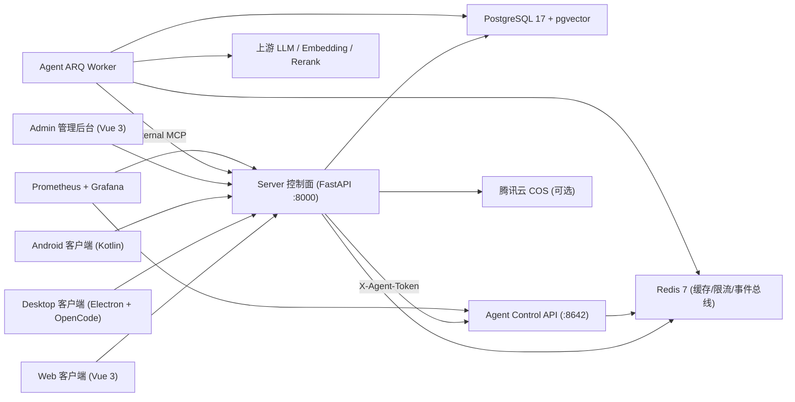

# Whitz

Whitz 是一个多端协同的 Personal Agent 工作台，采用 **FastAPI 多租户控制面（`server`）+ LangGraph 独立多智能体运行时（`agent`）+ 统一混合 RAG 引擎（`shared`）** 架构，并原生覆盖 **Web、Desktop（Windows/Electron）、Android、Admin 管理后台** 四大客户端。

## 系统架构



## 仓库结构

| 模块 | 技术栈 | 职责说明 | 文档 |
| --- | --- | --- | --- |
| `server/` | Python 3.12, FastAPI, SQLAlchemy, Alembic | 多租户后端控制面：认证鉴权、对话监督、文件/COS、记忆、定时任务、MCP、管理后台接口 | [server/README.md](server/README.md) |
| `agent/` | Python 3.12, LangGraph, ARQ, FastAPI | 独立多智能体运行时：图编排、工具沙箱、MCP 客户端、混合 RAG 与后台 Worker | [agent/README.md](agent/README.md) |
| `shared/` | Python 3.12 (`whitz_rag`) | 共享 RAG 检索包：双驱动 `DbAdapter`、CJK Bigram 分词、RRF 融合与 MMR 去重 | [shared/README.md](shared/README.md) |
| `web/` | Vue 3, TypeScript, Vite, Pinia, Tailwind v4 | 主站 Web 应用：SSE 流式对话、文件工作区、记忆管理、动态帖、定时任务 | [web/README.md](web/README.md) |
| `admin/` | Vue 3, TypeScript, Vite, Pinia, Tailwind v4 | 运营与运维管理后台：总览监控、用户与邀请码、审计日志、量化与运维面板 | [admin/README.md](admin/README.md) |
| `desktop/` | Electron 38, electron-vite, Vue 3, SQLite, xterm | Windows 桌面端：本地 SQLite 工作区、OpenCode 本地运行时、PTY 终端与策略校验 | [desktop/README.md](desktop/README.md) |
| `android/` | Kotlin, Jetpack Compose, Gradle | Android 移动端客户端 | [android/README.md](android/README.md) |
| `ops/` | Prometheus, Grafana | 可观测性与指标采集配置 | [ops/README.md](ops/README.md) |

## 专题文档

- [系统架构说明](docs/architecture.md)
- [部署与 CI/CD 指南](docs/deployment.md)
- [环境变量参考](docs/environment.md)
- [API 接口概览](docs/api.md)
- [测试指南](docs/testing.md)

## 快速开始

### 1. Docker Compose 一键启动后端与基础设施

1. 复制环境变量模板并填写必要密钥（至少修改 `JWT_SECRET`、`AGENT_INTERNAL_TOKEN`、`ADMIN_PASSWORD` 与 `LLM_*`）：

```bash
cp .env.example .env
```

2. 启动 PostgreSQL（pgvector）、Redis、`server`、`agent-api`、`agent-worker` 等服务：

```bash
docker compose up -d
```

服务就绪后可访问：
- Server 健康检查：`http://localhost:8000/api/health`
- Server 就绪检查：`http://localhost:8000/api/ready`
- Agent Control API 健康检查：`http://localhost:8642/health`

### 2. 本地前端与桌面端开发

```bash
# Web 主站（默认 http://localhost:5173）
cd web && npm ci && npm run dev

# Admin 管理后台
cd admin && npm ci && npm run dev

# Desktop 桌面端（默认 http://localhost:5174）
cd desktop && npm ci && npm run dev
```

## 运行测试

```bash
# 详见 docs/testing.md（server 测试需要 docker compose up -d postgres）
# 前端与桌面端（Node 24 原生 node --test + TypeScript 类型检查）
cd web && npm run typecheck && npm test
cd admin && npm run typecheck && npm test
cd desktop && npm run typecheck && npm test

# 共享 RAG 包（pytest）
cd shared && ../server/.venv/Scripts/python.exe -m pytest tests -q

# Server 与 Agent（需在各自虚拟环境中执行）
cd server && ./.venv/Scripts/python.exe -m pytest -q
cd agent && ./.venv/Scripts/python.exe -m pytest -q
```
