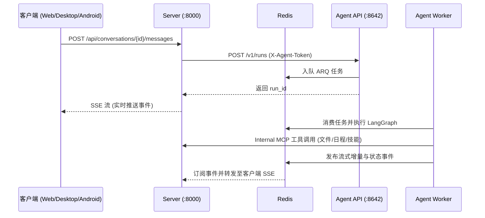

# 系统架构说明

## 总体分层

Whitz 采用**控制面与运行时解耦**的多服务架构，结合共享 RAG 检索引擎与多端客户端：

1. **接入与控制面（`server`）**
   - 基于 FastAPI + SQLAlchemy Async + PostgreSQL/pgvector + Redis。
   - 负责用户认证（JWT + HttpOnly Refresh Cookie）、多租户数据隔离、积分与会员限额、文件上传预签名（腾讯云 COS）、SSE 事件总线、定时任务调度与管理后台接口。
   - 通过 `run_supervisor` 管理对话运行生命周期，并将实际推理执行委派给 `agent`。

2. **多智能体运行时（`agent`）**
   - 由两部分组成：
     - **`agent-api`（`:8642`）**：FastAPI Control API，接收来自 `server` 的运行创建、恢复、取消与事件订阅请求（通过 `X-Agent-Token` 鉴权）。
     - **`agent-worker`**：基于 ARQ（Redis 队列）的异步 Worker，执行 LangGraph 状态图、工具调用、Docker/E2B 沙箱代码执行以及通过 Internal MCP 回调 `server` 工具。
   - 使用 `langgraph-checkpoint-postgres` 持久化图状态，支持断线重连与人工审批恢复（resume）。

3. **统一混合 RAG 引擎（`shared/whitz_rag`）**
   - 供 `server`（SQLAlchemy `AsyncSession`）和 `agent`（`psycopg3` `AsyncConnectionPool`）共同复用。
   - 通过 `DbAdapter` 抽象双驱动差异，结合：
     - **pgvector 向量检索**（支持 HNSW `iterative_scan` 自动探测与回退）；
     - **PostgreSQL `pg_trgm` + `simple` FTS**（配合 `expand_cjk_bigrams` 增强中文召回）；
     - **RRF（Reciprocal Rank Fusion）** 融合排序、可选 Stage-2 Reranker 重排与 **MMR** 多样性去重。

4. **多端客户端**
   - **`web`**：Vue 3 + Pinia + Tailwind CSS v4，支持 SSE 帧合并渲染（`streamDeltaCoalescer`）、内联文件引用（`[[file:uuid|name]]`）、Markdown/KaTeX/Mermaid 与异步任务审批。
   - **`admin`**：Vue 3 独立管理后台，使用内存 Access Token + HttpOnly Cookie 自动刷新，覆盖用户管理、审计链校验、SLO 告警与量化评估面板。
   - **`desktop`**：Electron 38 Windows 客户端，在主进程内集成 SQLite 本地工作区（`better-sqlite3`）、OpenCode 本地运行时与本地 OpenAI 兼容网关、PTY 终端（`xterm`）以及 Ed25519 策略签名校验（`policyService`）。
   - **`android`**：Kotlin 原生移动端，与后端共享流式管道与文件令牌解析规则。

## 关键数据流

### 对话与流式输出

